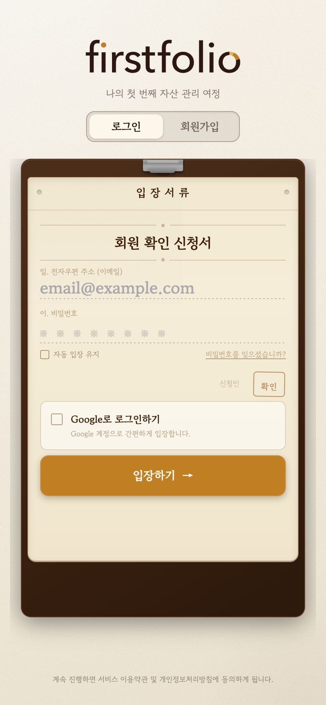
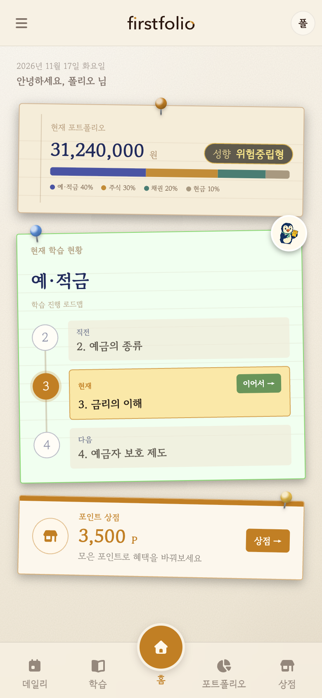
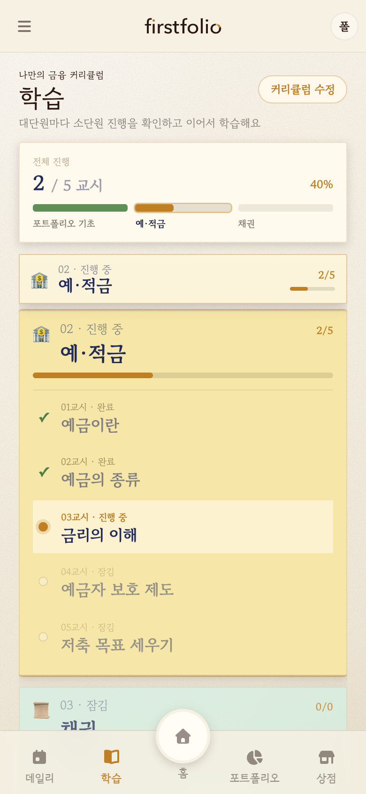
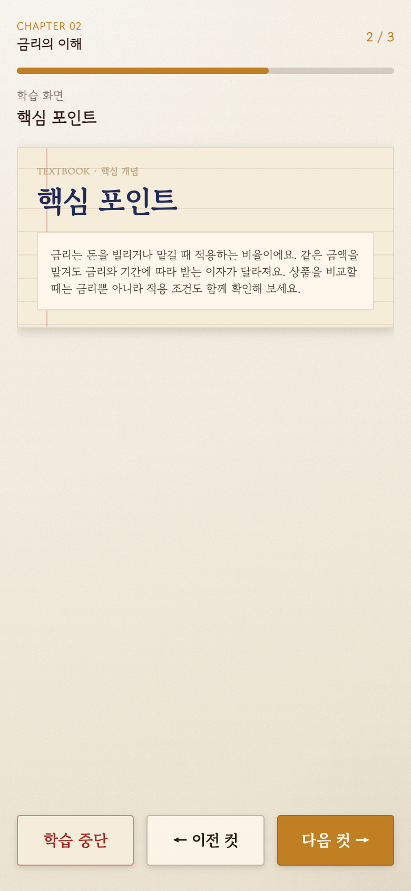
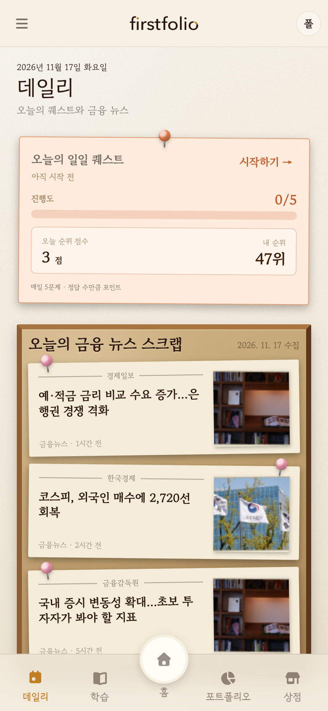
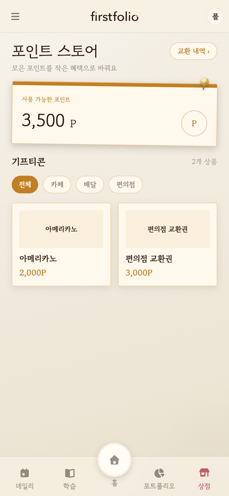
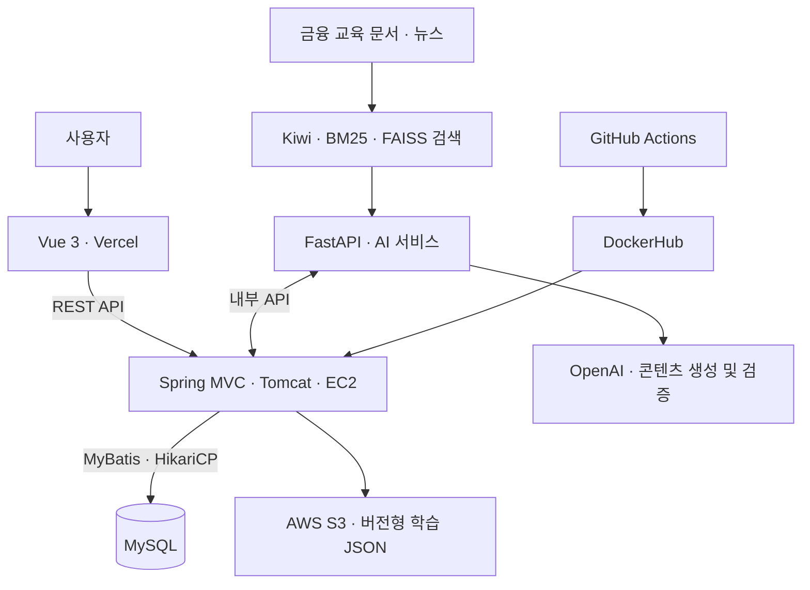

  

**금융을 배우고, 나만의 포트폴리오로 경험하세요.**

[Frontend](https://github.com/KB7-25-2/FirstFolio-FE) · [Backend](https://github.com/KB7-25-2/FirstFolio-BE) · [AI](https://github.com/KB7-25-2/FirstFolio-AI)

---

## 프로젝트 소개

> 금리와 배당을 배워도, 내 자산을 어떻게 나눠야 할지는 막막합니다. 
> firstfolio는 금융 지식을 배우는 과정과 직접 선택해 보는 경험을 연결합니다.

**firstfolio는 고등학생을 위한 금융 학습·모의 자산 관리 서비스입니다.** 
레벨 테스트로 출발점을 확인하고, 나에게 필요한 커리큘럼을 직접 정합니다. 
포트폴리오 기초 과정을 마치면 **3,000만 원의 모의투자금**으로 첫 포트폴리오를 만듭니다. 
예·적금, 채권, 주식, 펀드를 배우면서 자산 배분을 조정하고, 압축된 시간 안에서 만기·이자·배당을 경험합니다.

## 서비스 화면

| `01` 시작하기 | `02` 홈 | `03` 나의 커리큘럼 |
| :---: | :---: | :---: |
|  |  |  |
| 금융 학습을 시작하는 첫 진입 화면 | 나의 자산과 학습 현황을 한곳에서 확인 | 선택한 금융 주제를 순서대로 학습 |

| `04` 소단원 학습 | `05` 데일리 | `06` 포인트 상점 |
| :---: | :---: | :---: |
|  |  |  |
| 금융 개념을 익히고 퀴즈로 이해도를 확인 | 매일 다섯 문제와 금융 뉴스로 지속적 학습 | 학습하며 모은 포인트를 혜택으로 교환 |

## 💡 학습이 경험으로 이어지는 방식

| 단계 | 경험 |
| --- | --- |
| 진단과 선택 | 오답 대단원을 자동 추천합니다. 정답 대단원도 추가할 수 있으며, 최종 커리큘럼과 순서는 사용자가 결정합니다. |
| 기초와 실습 | 모든 사용자가 포트폴리오 기초 과정을 먼저 이수한 뒤 모의투자금 3,000만 원을 지급받습니다. |
| 자산 구성 | 예·적금, 채권, 주식, 펀드의 모든 모의 상품을 처음부터 선택할 수 있습니다. 학습 여부로 상품을 잠그지 않습니다. |
| 변화와 재학습 | 압축된 시간 안에서 자산 변화를 경험하고, 학습과 복습을 통해 포트폴리오를 조정합니다. |
| 꾸준한 참여 | 퀴즈 정답 수에 따라 포인트를 받고, 출석·일일 퀘스트·리더보드로 학습을 이어갑니다. |

**포인트와 모의투자금은 별개입니다.** 포인트는 기프티콘 교환에, 모의투자금은 가상 자산 구성에 사용하며 서로 전환하지 않습니다.

## ⛓️ 시스템 구조

사용자 상태와 자산 계산은 **Spring 메인 서버**, 금융 문서 검색과 콘텐츠 생성은 **AI 서비스**가 담당합니다. 
AI가 만든 콘텐츠는 내부 API로 전달하고, 메인 서버가 최종 저장과 게시를 담당합니다.

<b>데이터와 이력을 관리하는 원칙</b>

- **상태와 콘텐츠 분리**: 사용자 상태·보상·거래·퀴즈 문항은 MySQL에, 학습 본문은 S3의 버전형 JSON에 저장합니다.
- **학습 당시 버전 보존**: 콘텐츠 버전과 출제 당시 문항 스냅샷을 연결해 과거 학습과 채점 결과를 재현하도록 설계합니다.
- **중복 반영 방지**: 포인트 지급과 모의 자산 이벤트는 중복 요청에도 한 번만 반영하고, 답안·진도·거래·초기화 이력을 보존합니다.
- **근거와 기준 시점**: 뉴스 등 최신성에 민감한 AI 콘텐츠는 출처와 기준 시점을 연결합니다.
- **교육용 상품 표현**: 실제 데이터를 활용하되 상품명과 식별 정보는 가명 처리하고, 서비스 시간과 실제 상품 기간을 함께 안내합니다.

## 📂 저장소

| 저장소 | 역할 |
| --- | --- |
| [**FirstFolio-FE**](https://github.com/KB7-25-2/FirstFolio-FE) | Vue 기반 사용자 화면, 학습 흐름, 포트폴리오 대시보드 |
| [**FirstFolio-BE**](https://github.com/KB7-25-2/FirstFolio-BE) | 인증·인가, 커리큘럼, 학습·퀴즈, 포인트, 모의 자산 관리 |
| [**FirstFolio-AI**](https://github.com/KB7-25-2/FirstFolio-AI) | 금융 문서 검색, RAG 기반 퀴즈·금융 콘텐츠 생성과 검증 |

## 🛠️ 기술 스택

| 영역 | 기술 |
| --- | --- |
| Frontend | Vue 3 · Vite · Tailwind CSS · Vue Router · Pinia |
| Backend | Java 17 · Spring Framework Legacy · Spring MVC · MyBatis · Gradle · Tomcat |
| Database | MySQL · HikariCP |
| AI | Python · FastAPI · LangChain · OpenAI API · Kiwi · BM25 · FAISS |
| Content | AWS S3 · 버전형 JSON |
| 배포 | Vercel · GitHub Actions · Docker · DockerHub · AWS EC2 |
| 관측 | Micrometer · Prometheus · Grafana |

<!-- 팀원과 GitHub 계정, 역할은 확인 후 추가합니다. 배포 URL·시연 영상·프로젝트 기간도 실제 정보로 보완합니다. -->

---

**firstfolio — 배우며 완성하는 나의 첫 자산 포트폴리오**

